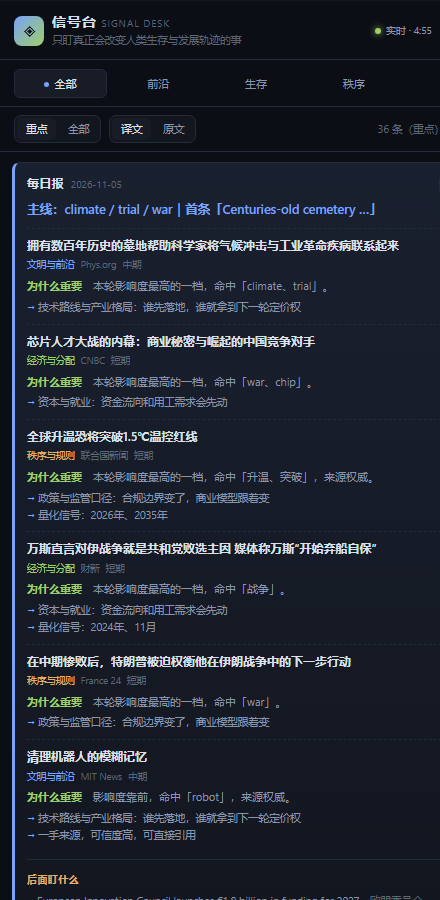

# 信号台 Signal Desk

> 只盯真正会改变人类生存与发展轨迹的事。



> 截图为 v2 界面，按 440px 桌面摆件宽度渲染。

一个桌面信息摆件：把分散在 87 家中外机构与媒体的**公开 RSS** 汇成一块小面板，每条信号直接给出要点，不用点开原文也能读完。不刷、不推、不制造焦虑——抬眼一瞥，看完就走。

在线地址：**https://Nosweet1.github.io/signal-desk/**
本地源码：`D:\github\signal-desk\`

---

## v2 改了什么

| 之前的麻烦 | 现在 |
|---|---|
| 摘要要鼠标悬停才展开，还是英文描述硬截 220 字，常断在半句 | 每条卡片默认铺开要点；顶部多一块「本轮速览」，抬眼就能看完最重要的 5 条 |
| 只有 10 条，想知道讲什么必须点进原文 | 24 条重点 + 60 条全集，一键切换；标题与「原文 ↗」仍可点 |
| 刷新写死 5 分钟，没法调 | 设置面板可选 2 / 5 / 15 / 30 分钟或「仅手动」，可设后台暂停，带倒计时，本地记住 |
| 33 个源，官方机构少 | 87 个源，其中 39 个权威级；新增央行、监管机构、顶刊、通讯社、AI 实验室官方博客 |

## 为什么不需要爬虫

中文主流科技/综合媒体大多有官方 RSS。这个项目只订阅公开 feed，取标题和描述并附原文链接：

- 不登录、不绕验证码、不碰付费墙
- 不抓微信公众号（无官方 RSS，是唯一会踩账号/验证问题的地方，第一版直接绕开）
- 不使用任何第三方聚合服务的数据

所以「订阅栏目数量」没有上限，也不存在被封号的风险。RSS 会下线、会改版、会变成不更新的存档页，因此数据层对每个源做**健康检查**：抓不到就标记降级并跳过，摆件底部能展开看到失败清单，绝不会整块变空白。

一个真实踩过的坑：新华社时政 RSS 仍返回 200，但内容是 2022 年的存档且**完全没有 `pubDate`**。早期版本把无日期条目当作「刚刚发布」，旧闻直接霸占榜首。现在无有效发布时间的条目一律丢弃，该源也已从清单移除。

## 信源构成

108 个源，分四个维度，避免被 AI 或消费电子刷屏：

| 栏目 | 关注什么 | 代表信源 |
|---|---|---|
| 文明与前沿 | AI、基础科学、航天、算力 | Nature 系列、Science、PNAS、Cell、MIT News、NIST、NASA、OpenAI、DeepMind、MIT 科技评论、量子位、36氪快讯、Solidot |
| 生存底线 | 气候、能源、粮食、公共卫生 | WHO、CDC、FDA、IPCC、柳叶刀、NEJM、Carbon Brief、STAT、Inside Climate News |
| 秩序与规则 | 政策、监管、国际组织、冲突 | 联合国新闻（中/英）、中国政府网、人民网、欧盟委员会、中新网国际、NPR、BBC、Guardian |
| 经济与分配 | 宏观、就业、产业、资本 | 美联储、ECB、IMF、FT、华尔街日报、彭博、CNBC、财新、华尔街见闻、虎嗅、人民网财经 |

- 本机实测约 79 家可直连（网络波动 ±2）；其余标 `tier: cloud` 的境外源本机不可达，交给 GitHub Actions 境外机器自动尝试——能通就自动生效，不通就静默降级。
- 权威级 39 家（`authority: 5`）：国际组织、央行与监管机构、顶级期刊、国家级媒体、航天机构等。这一级别会参与评分加成，并在卡片上标「权威源」。
- 加源前先用 `node scripts/probe.mjs` 批量探测，它把结果分成 可用 / 交云端 / 死链 三类。这一轮据此剔除了 21 个死链——世界银行、OECD、WTO、FAO、IEA、UNEP、CERN、ESA、Anthropic、财新、澎湃、第一财经、界面等的 RSS 已下线或返回非 XML。
- 高产量 feed（arXiv、OpenAI、CDC、人民网、Nature 系列…）用 `cap` 限制单源取数，避免论文流和博客归档把版面占满；抓取改成分批 12 路并发，防止 100+ 请求同时打出去被限流。

### 微信公众号怎么接

公众号没有官方 RSS，走 [Wechat2RSS](https://wechat2rss.xlab.app/) 的公共实例（免费覆盖 300+ 号，更新周期约 24 小时）：

```
node scripts/add-wechat.mjs 机器之心            # 按名字接入，默认放进「文明与前沿」
node scripts/add-wechat.mjs 猫笔刀 economy      # 指定栏目
node scripts/add-wechat.mjs --search 芯片       # 先在列表里搜一下有哪些号
node scripts/add-wechat.mjs --list              # 看已接入的号
node scripts/fetch.mjs                          # 立刻重抓
```

脚本会自动做三件事：在官方列表里匹配名字、抓一次确认有更新（停更号会警告）、写进 `sources.json`（`type: wechat`）。

已接入 17 个：机器之心、量子位、新智元、PaperWeekly、夕小瑶科技说、集智俱乐部、极客公园、差评、傅盛、猫笔刀、思想钢印、42章经、奇安信威胁情报中心、慢雾科技、空天防务观察、腾讯技术工程、阿里技术。

公众号是单源观点，纯按热度排序会被通讯社通稿挤掉，所以 `sources.json` 里设了 `minWechat: 3` 的保底席位，卡片上标「公众号」。**要接自己的号**：公共实例没收录的，需要自建 Wechat2RSS（付费私有部署或 docker 自托管），把生成的 `feed/<id>.xml` 地址按同样格式加进 `sources.json` 即可，其余逻辑完全不用改。

### 36氪这类「官方 RSS 已下线」的媒体

36氪、财新、虎嗅、华尔街见闻的官网 RSS 都已停掉，改走 RSSHub 路由。公共实例经常单点挂掉，所以每个源配了 `mirrors` 数组，主地址失败自动依次重试：

```json
{ "name": "36氪 快讯", "url": "https://rsshub.rssforever.com/36kr/newsflashes",
  "mirrors": ["https://rsshub.ktachibana.party/36kr/newsflashes", "..."] }
```

另外 36氪快讯是单源短讯，天然拼不过多源转载的通稿，`sources.json` 里用 `reserveSources: [{ match: "36氪", min: 2 }]` 给它留了两个保底位置。

## 每日报（选重要 + 判影响）

每天早上 07:20（北京时间）由 GitHub Actions 自动生成一份要报：从当天扫描的全部信号里挑 4–6 条真正重要的，逐条写清「为什么重要 / 会有什么影响 / 影响 horizon / 置信度」，末尾附 3 条「接下来盯什么」。页面顶部固定展示，存档在 `data/daily/YYYY-MM-DD.json`。

**大模型怎么接（都有免费档，按优先级自动选，全不配就退规则模板）：**

| 方案 | 配置 | 成本 |
|---|---|---|
| 任意 OpenAI 兼容接口 | Secrets: `DAILY_LLM_BASE` `DAILY_LLM_KEY` `DAILY_LLM_MODEL`（SiliconFlow 免费模型 / DeepSeek / 智谱 / Groq / OpenRouter 均可） | 免费或每次约 ¥0.001 |
| Google Gemini 免费层 | Secrets: `GEMINI_API_KEY` | 免费（1500 次/天，只用 1 次） |
| **GitHub Models（默认）** | 不用配任何东西，Actions 自带 `GITHUB_TOKEN` | 免费 |
| 规则模板 | 什么都不配 | 0 元，判断是模板句 |

**反幻觉约束**：模型只能从给定的 10 条候选里用编号选条目，编号越界的直接丢弃；why/impact 长度截断校验；可用条目不足 3 条整篇回退规则版——模型挂了日报照出，只是判断变保守。

本地手动生成：`node scripts/daily.mjs`（有环境变量就走模型，没有就走规则）。排查生成质量：`node scripts/daily.mjs --rules` 只看规则版。

## 摘要是怎么来的（抽取式，不是生成式）

零依赖、零 API Key，所以要点是规则抽取的：

1. 取同一事件下所有成员的描述，**中文描述优先**，其次权威级别高、权重高的源
2. 切句 → 去掉「中新网长春11月5日电 (记者…)」这类电头套话和样板句 → 按「含数字、含动作动词、与标题重复度」打分，选 1–2 句
3. 按原文顺序拼回，长句在逗号或空格边界收尾（不切半个英文单词），总长约 190 字
4. 另外抽出关键数字（如 `3050亿美元`、`1.5℃`）做成小标签；完全没有描述时给一条可读说明，不留白

英文源的要点保留英文，卡片上标 `EN 摘要`；同题有中文报道时优先用中文要点。**目前不翻译、不生成**，这是已知边界。

## 排序逻辑（可解释，不是黑盒）

```
score = (信源权重 + 权威加成 + 关键词信号 + 跨源加成 + 中文加成 + 无信号惩罚) × 时效衰减
```

- **信源权重**：联合国 / WHO / Nature 这类一手源给 5 分，消费类媒体给 2 分
- **权威加成**：`authority` 5 比 3 多 1.4 分
- **关键词信号**：命中「气候、疫情、AGI、核聚变、粮食、战争、央行…」加分；命中「开箱、评测、优惠券、消费升温…」扣分。短英文词按词边界匹配，避免 `war` 误命中 `warming`
- **歧义守卫**：「升温」只有与气候语境（气候 / 气温 / 全球变暖 / ℃ …）同现才算信号，避免「汽车消费持续升温」冒充气候新闻顶到榜首
- **无信号惩罚**：一个关键词都不命中的消息 -0.8，自然沉底
- **跨源加成**：同一件事被 N 家报道 → 合并成一条，并显示「N 家报道」
- **时效衰减**：30 小时半衰期，旧闻自然沉底；无日期条目直接丢弃
- **两条配额**：每个栏目最多 8 条且保底 1 条、同一信源最多 3 条

关键词表、权重、信源清单全在 `sources.json`，改完 push 就会触发重新抓取。

## 刷新模式

要分清两件事：

| | 谁在做 | 频率 | 怎么改 |
|---|---|---|---|
| 云端抓取 | GitHub Actions 抓 108 个 RSS/公众号、生成 `data/feed.js`、部署 Pages | 每 30 分钟 | 改 `.github/workflows/fetch.yml` 里的 `cron` |
| 页面刷新 | 浏览器重新下载一次 `data/feed.js` | 2 / 5 / 15 / 30 分钟 / 仅手动 | 右上角 ⚙，或按 `S` |

前端刷新**不会触发重新抓取**，只是把云端已生成的数据再取一遍。想立刻重抓：本机跑 `refresh.cmd`，或在 GitHub Actions 页面点 `Run workflow`。

设置项存在浏览器 localStorage：刷新模式、窗口隐藏时暂停、是否显示速览、重点/全集视图。状态栏显示数据年龄与下次刷新倒计时；窗口隐藏时自动跳过轮询，回来后立刻补一次。

## 目录

```
sources.json                      信源 + 分类 + 关键词表（主要调参入口）
scripts/fetch.mjs                 抓取 / 清洗 / 要点抽取 / 合并 / 评分，零第三方依赖
scripts/probe.mjs                 批量探测信源可用性（ok / cloud / dead）
scripts/probe-wechat.mjs          公众号批量体检（条目数 / 最新更新时间，筛停更号）
scripts/add-wechat.mjs            按名字接入某个公众号，自动校验并写进 sources.json
scripts/daily.mjs                 每日报生成（模型 / 规则双引擎 + 反幻觉校验）
.github/workflows/daily.yml       每天 07:20 生成日报并存档、部署
manifest.json / sw.js / icon.svg  PWA：手机加到桌面当 App 用
scripts/source-candidates.json    候选新源清单，探测用
data/feed.js                      生成的数据（页面当脚本加载，避开 CORS）
index.html                        摆件界面，无外部资源
.github/workflows/fetch.yml       定时抓取 + 云端打包部署 Pages
desk.cmd                          Windows 启动器（Chrome 无边框窗口）
refresh.cmd                       本机手动抓一次（离线兜底）
```

## 怎么用

**1. 桌面摆件**：双击 `desk.cmd`。它会用独立配置目录启动一个无边框 Chrome 窗口（440×820），不干扰你日常浏览器。窗口位置在 `desk.cmd` 里的 `POS` 变量，按屏幕分辨率改。

**2. 浏览器**：直接开在线地址，手机也能用。

**2.5 手机当 App 用（PWA，无需装任何东西）**：手机浏览器（Chrome / Edge / Safari）打开在线地址 → 菜单里选「添加到主屏幕」。之后从桌面图标启动就是全屏独立窗口，有离线兜底（断网也能看上一份数据），图标是信号台雷达标。安卓、iPhone 都行。

**3. 快捷键**：`R` 刷新，`V` 切重点/全集，`S` 打开设置，`0` 看全部栏目，`1`–`4` 切栏目。所有卡片默认显示要点，点标题或「原文 ↗」跳原文。

**4. 完全离线**：`refresh.cmd` 会在本地重新抓一次并写入 `data/feed.js`，之后用浏览器打开本地 `index.html` 也能看。

**关于置顶**：Chrome 的无边框窗口没有原生置顶参数，本机安全策略也禁止编译置顶小工具（`Add-Type` / C# 编译器都被拦）。两个替代方案：安装微软官方 **PowerToys**，选中窗口按 `Win+Ctrl+T` 即可置顶；或者就把摆件停在屏幕一侧（默认已设在右上），不遮挡工作区。

## 成本

**0 元 / 月，不需要服务器，不需要任何 API Key。**（公众号走 Wechat2RSS 公共实例，也免费）

108 个源分 12 路并发抓一次约 1–2 分钟，每 30 分钟跑一次仍在 GitHub Actions 免费额度内（2000 分钟/月），Pages 免费托管。每次构建在云端重新抓取并把数据一起打包发布，不往仓库写回半小时一次的提交。仓库里的 `data/feed.js` 是一份快照，断网时可用 `refresh.cmd` 在本地更新。

## 已知边界

- 摘要是规则抽取，不是生成式 AI；英文源要点保持英文，卡片会标 `EN 摘要`
- 跨源合并用标题字符相似度，措辞差异极大的同题报道可能合并不到一起；宁可少合并，也不错杀
- 不做全文抓取、不做账号系统、不做翻译

## 后续路线

1. **中文摘要 / 翻译**：README 旧版提过可复用 SiliconFlow Key 接生成式摘要，但需要在 Actions 配 secret，会打破「零 Key」设计，暂未做
2. **手机版**：同一 URL 加 PWA manifest，加到主屏幕
3. **真正的桌面组件**：Tauri 打包 + 系统托盘 + 原生置顶
4. **趋势回顾**：按天归档 `feed.json`，看某个议题的热度曲线

## 关于那个「不想花的钱」

语鲸 Plus/Pro 卖的是更多频道额度、AI 全文拆解、语音朗读。我们不做它的复刻版：这里没有深度阅读器，也不搬它的付费内容。你不想付的钱，解法是**自己接公开信源**，而不是绕开别人的付费墙。
